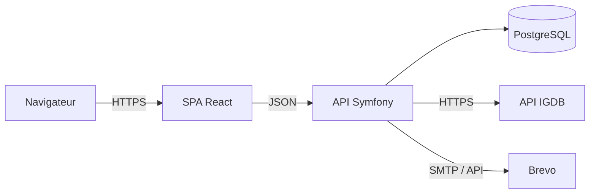

# Spécifications techniques — Ludarchive

## Objet du document

Ce document décrit l'architecture et les choix techniques de Ludarchive. Il est mis à jour à chaque nouveau choix technique.

## Documents de référence

| Document | Contenu |
|---|---|
| Cahier des charges 1.0 (`docs/Ludarchive-CDC.pdf`) | Exigences fonctionnelles et non fonctionnelles |
| `CONTRIBUTING.md` | Règles de travail : branches, commits, revues, normes de code |

## 1. Architecture

Ludarchive suit une architecture **API + SPA** :

- une **API REST** Symfony, qui expose les données en JSON ;
- une **SPA** (*Single Page Application*) React, qui gère toute l'interface ;
- une base **PostgreSQL** ;
- l'API **IGDB**, appelée uniquement par le serveur.

**Justification.** Application grand public, avec recherche, carrousels et pages dynamiques : une interface séparée offre une expérience réactive, et l'approche par composants de React convient aux listes et aux cartes. La séparation facilite aussi les tests de bout en bout.

**Coût assumé.** Deux projets à maintenir, une authentification par API, une gestion des erreurs des deux côtés : plus de travail qu'une application Symfony monolithique (Twig). Ce coût est absorbé par le découpage MVP / après MVP.

## 2. Technologies

| Rôle | Choix | Justification |
|---|---|---|
| Langage back | PHP 8.6 | Dernière version stable |
| Framework back | Symfony 7.4 LTS | Imposé (SOC-1) ; support jusqu'en novembre 2029 |
| Accès aux données | Doctrine ORM | ORM standard de Symfony |
| Interface | React 19, Vite | Bibliothèque la plus répandue pour les SPA ; Vite est l'outil de build de référence |
| Styles et composants | Tailwind CSS, HeroUI | Framework CSS le plus répandu ; composants accessibles (React Aria), personnalisables par thème, avec un kit Figma officiel pour les maquettes |
| Base de données | PostgreSQL 19 | Relationnelle (SOC-2) ; préférée à MySQL et MariaDB pour son type JSONB, indexable et interrogeable, et sa recherche plein texte configurable par langue |
| Conteneurs | Docker, Docker Compose | Imposé (SOC-3) |
| Intégration continue | GitHub Actions | Intégré au dépôt GitHub |
| Emails transactionnels | Brevo, offre gratuite | 300 emails par jour, API et SMTP |
| Données des jeux | API IGDB (Twitch) | Base de jeux la plus complète, gratuite pour un usage non commercial |
| Hébergement | VPS OVH | Serveur dédié au projet, compatible Docker |

## 3. Données

- **Modèle relationnel** conçu avec Merise, implémenté avec Doctrine et ses migrations.
- **Données brutes d'IGDB** conservées dans une colonne **JSONB** : relecture d'un jeu sans rappeler IGDB, nouveaux champs exploitables sans changer le schéma. Ce stockage orienté documents couvre l'attendu NoSQL du projet.
- **Recherche** par titre et par pseudo : recherche plein texte de PostgreSQL.
- **Images des membres** : fichiers sur un volume Docker du serveur. Les jaquettes restent des liens vers IGDB.

## 4. Réponse aux exigences non fonctionnelles

| Exigence | Réponse technique |
|---|---|
| SOC-1 | Symfony 7.4 LTS en API, consommée par React |
| SOC-2 | PostgreSQL 19, schéma Merise |
| SOC-3 | Docker Compose en développement et en production |
| SOC-4 | GitHub, GitFlow sans branches de release (voir `CONTRIBUTING.md`) |
| SOC-5 | GitHub Actions : PHPUnit, Vitest, Playwright à chaque push |
| SOC-6 | IGDB et Brevo, clés dans des variables d'environnement |
| SOC-7 | VPS OVH, HTTPS avec Let's Encrypt |
| SEC-1 | Requêtes paramétrées Doctrine (injection), échappement automatique de React (XSS), protection CSRF de Symfony, en-têtes de sécurité HTTP |
| SEC-2 | Hacheur de mots de passe Symfony (algorithme `auto`) ; contrôle d'accès par rôles (`ROLE_USER`, `ROLE_ADMIN`) |
| SEC-3 | Limitation des connexions de Symfony (*login throttling*) |
| SEC-4 | Contraintes de validation Symfony, dont la vérification du type MIME réel des images |
| SEC-5 | Convention Symfony : `.env` versionné sans secret, `.env.local` non versionné pour les secrets en local ; variables d'environnement du serveur en production ; secrets GitHub pour la CI et le déploiement. Aucun secret côté front : les variables `VITE_*` sont lisibles dans le navigateur |
| FIA-1 | Redémarrage automatique des conteneurs ; supervision de disponibilité externe |
| FIA-2 | Tâche planifiée quotidienne : export de la base avec `pg_dump` (outil de sauvegarde de PostgreSQL) et copie du dossier des images des membres ; rotation sur 7 jours, copie hors du serveur |
| FIA-3 | Monolog, la bibliothèque de journaux de Symfony, avec un canal dédié à la sécurité |
| IHM-1 | Mise en page *mobile first* avec Tailwind CSS |
| IHM-2, IHM-3 | Composants accessibles de HeroUI (React Aria) ; audits Lighthouse et axe ; tests d'accessibilité axe dans Playwright |
| IHM-4 | Playwright, qui exécute les tests dans Chromium, Firefox et WebKit |
| PERF-1 | Index plein texte PostgreSQL ; mesure du p95 avec k6 |
| PERF-2 | Mesure avec Lighthouse |
| EXT-1 à EXT-3 | Client IGDB côté serveur (HttpClient de Symfony), quota de 4 requêtes par seconde respecté par limitation des appels, crédit IGDB dans le pied de page |
| QUA-1 | Mise en forme : PHP-CS-Fixer (PSR-12) et Prettier ; analyse statique : PHPStan et ESLint. Exécutés dans l'éditeur et vérifiés par la CI, qui bloque une pull request non conforme |
| QUA-2 | Taux de couverture mesuré par PHPUnit et Vitest, affiché dans le résumé de chaque exécution de la CI |

## 5. Déploiement

- **Environnements** : développement local (Docker Compose dans WSL) et production (Docker Compose sur le VPS).
- **Pipeline** : à chaque pull request, la CI lance les tests et les outils de qualité ; une fusion dans `main` déclenche le déploiement automatique sur le VPS par SSH.
- **Adresse** : `ludarchive.com`, en HTTPS (Let's Encrypt).
- **Compte administrateur** : créé par une commande console Symfony sur le serveur, jamais par un formulaire du site.

## 6. Décisions à prendre

| Décision | Échéance |
|---|---|
| Organisation du dépôt (dossiers de l'API et du front) | Sprint 1 |
| Serveur web et image Docker de l'API | Sprint 1 |
| Authentification de l'API (session ou jeton) | Sprint où arrive la connexion |
